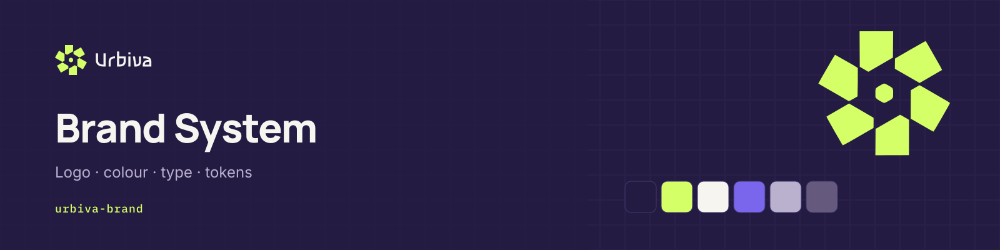
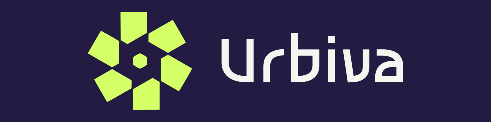
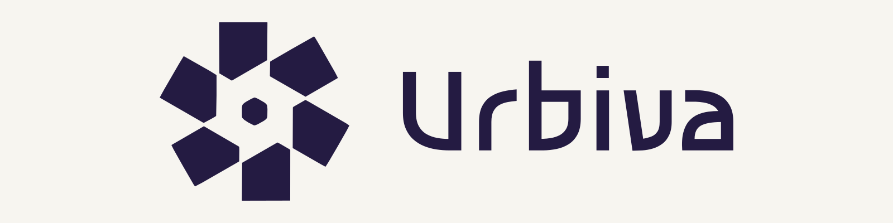

<picture>
  <source media="(prefers-color-scheme: light)" srcset="docs/header-urbiva-brand-light.png">
  
</picture>

# urbiva-brand

**Official Urbiva brand assets, visual identity, design tokens, and design guidelines.**

This repository is the single source for the approved Urbiva identity: the logo package v1.0, colour and type rules, design tokens that mirror the Figma design system v1.0, and the GitHub brand kit.

> The identity is frozen. Do not redraw, retype or recolour the logo. Propose changes through a pull request with a design rationale.

## Name and tagline

- Brand name: **Urbiva** (capital U only; never all caps in running text).
- Tagline: **Every city. Every possibility.**
- Positioning: AI-powered urban accessibility intelligence.

## Logo

<p>
  
  
</p>

The logo package contains 24 variants (`L01` to `L24`) as outlined SVG, PDF and PNG. Editable masters with live text are in `masters/` and need the bundled Asimovian font. Full rules: [guidelines/URBIVA_Logo_Guidelines_v1.0.pdf](guidelines/URBIVA_Logo_Guidelines_v1.0.pdf) and [docs/logo-usage.md](docs/logo-usage.md).

| Need | Use |
| --- | --- |
| Dark backgrounds | `L07` Dark-Mode-Transparent, `L03` on Midnight Violet |
| Light backgrounds | `L08` Light-Mode-Transparent, `L05` on Porcelain White |
| Icon only | `L09` to `L12` |
| Avatars and social | `L24` Social-Profile, `github/png/urbiva-avatar-*` |
| Favicon and app icon | `L23` Favicon, `L22` App-Icon |
| One colour | `L15` Monochrome-Black, `L16` Monochrome-White |

## Colour

| Name | Hex | Role |
| --- | --- | --- |
| Midnight Violet | `#241B42` | Dark background, text on light |
| Volt Lime | `#D5FF66` | Signature accent, primary action on dark |
| Porcelain White | `#F7F5F0` | Light background, text on dark |
| Digital Iris | `#7966EC` | Graphics, selection, large text only |
| Muted Lavender | `#B9B1CE` | Secondary text on dark |
| Light Secondary | `#655A7D` | Secondary text on light |

Product UI uses colours only through semantic tokens (Dark and Light modes): [tokens/tokens.json](tokens/tokens.json), [tokens/tokens.css](tokens/tokens.css). Details: [docs/color.md](docs/color.md).

## Typography

| Use | Typeface | Source and licence |
| --- | --- | --- |
| Logo wordmark | Asimovian (outlined in logo files) | Bundled in `fonts/asimovian/`, SIL OFL 1.1 |
| Headings | Manrope | Google Fonts, SIL OFL 1.1 (not redistributed here) |
| Body and UI | Inter | Google Fonts, SIL OFL 1.1 (not redistributed here) |
| Data and labels | IBM Plex Mono | Google Fonts, SIL OFL 1.1 (not redistributed here) |

Manrope has no capital Ə (U+018F); Inter renders that glyph. See [docs/typography.md](docs/typography.md).

## Figma

| File | Purpose |
| --- | --- |
| [Urbiva product design system v1.0](https://www.figma.com/design/ViFYJDj0WGlvxAM3bvGBWG) | Tokens, components, all product screens, prototype. Design freeze. |
| Urbiva GitHub and Developer Brand Kit | Avatars, banners, social previews, headers, diagrams. Link in [docs/figma.md](docs/figma.md). |

Access to Figma files is managed in Figma; links here do not grant access.

## GitHub brand kit

`github/` holds the SVG masters and PNG renders for the organization avatar, profile banner, repository social previews (1280 × 640), repository headers, architecture diagram, module cards, dividers and status labels, each in Dark and Light. They are generated by `github/generate.py` from the master logo geometry in `logos/`; specifications are in [docs/github-assets.md](docs/github-assets.md).

## Repository structure

```
logos/        24 approved variants (SVG, PDF, PNG; favicon.ico in L23)
masters/      Editable SVG masters with live text
guidelines/   Logo guidelines PDF and overview sheet
fonts/        Asimovian font and its OFL licence
tokens/       Design tokens (JSON, CSS)
docs/         Colour, typography, logo usage, Figma, GitHub asset specifications
github/       GitHub brand kit (SVG masters, PNG renders, generator)
source/       Originally supplied icon artwork
```

## Urbiva repositories

| Repository | Purpose |
| --- | --- |
| [`urbiva-app`](https://github.com/urbiva/urbiva-app) | Application: Go, Vision, Urban and Impact |
| [`urbiva-ai`](https://github.com/urbiva/urbiva-ai) | Research setup for UVA-Net S10, a planned local vision model |
| **urbiva-brand** | Logo package, tokens, guidelines and GitHub brand kit |
| [`urbiva-docs`](https://github.com/urbiva/urbiva-docs) | Product specifications, architecture, decisions and roadmap |

## License

Brand assets: all rights reserved by Urbiva; use only for official Urbiva work. See [LICENSE](LICENSE). Asimovian: SIL Open Font License 1.1 (`fonts/asimovian/OFL.txt`).
